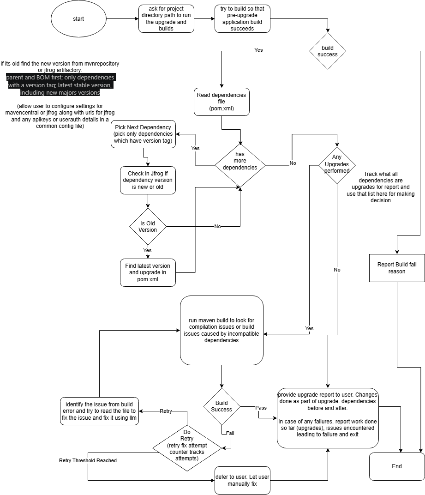

# agentic-java-upgrader

An agent that upgrades the dependencies of a Maven (Java) project to their newest stable versions and, when the build breaks, tries to repair it with an LLM. Built with LangChain and LangGraph.

> **Status: work in progress (v1).** The full flow runs end to end, but it is still being tuned on real projects. Run it only on a copy, or on a Git branch you can revert. See [Current status](#current-status).

## Credits
Designed And Developed by 
@avinash92c and @rahulneon

## How it works



1. **Preflight**: checks the project (Git is optional; if it is a Git repo, the working tree must be clean), that the model can make tool calls, and that the installed JDK can compile the project's Java version (if not, it offers to update it).
2. **Baseline build**: builds the project before any change. If that already fails, the run stops. Skipped after a Java version update, since old code is expected to need repairs.
3. **Collect dependencies**: reads the root `pom.xml` and every module's `pom.xml` and lists the dependencies that set a version.
4. **Upgrade loop**: for each dependency, finds the newest stable version on Maven Central and writes it into the POM.
5. **Build** once after all upgrades.
6. **Repair**: if the build fails, the errors become an issue list. The agent fixes one issue per round and rebuilds, with up to 3 tries per issue (configurable). Problems outside the code (downloads, credentials, network) go straight to you.
7. **Report**: a markdown report of what was upgraded, what was repaired, and what is left.

## Features

For every LLM tool and code function the agent uses, and what each one does, see [TOOLS.md](TOOLS.md).

### Dependencies and versions
- Reads single and multi-module projects (standard layout: modules listed under `<modules>`, each with its own `pom.xml`).
- Collects the parent POM, BOM imports, versioned `<dependencyManagement>` entries and versioned dependencies. Versions written as `${property}` are resolved through the POM and its parents. The project's own modules, plugins and profiles are skipped.
- Reads the published versions from Maven Central (`maven-metadata.xml`); an LLM picks the newest stable release (no alpha, beta, milestone, RC or SNAPSHOT; new major versions allowed). Code rejects any version that is not actually published.
- Writes each new version where it is defined (a literal `<version>` or a `${property}`, in the module or a parent POM), changing only that value; formatting and line endings are kept. A shared property is changed once.
- Parent and BOM upgrades are applied first, since they move the versions of the dependencies they manage.

### Build
- Runs `mvn -B clean install -DskipTests` (tests are not run; that is left to you).
- After every build, downloads the dependencies' `-sources.jar` files (`mvn dependency:sources`), so the repair step can read library source and javadoc locally.
- Classifies a failed build: problems outside the code (artifact downloads, 401/403, network, TLS) stop the run with a hint; code and POM problems go to repair.

### Repair
Each failed build is turned into an issue list, and each issue is categorised: `pom`, `dependency` (`package X does not exist`), `code` (compile error) or `other`. One issue is fixed per round, together with any other issue that has the same error (for example the same removed method used in several files); then the project is rebuilt. `max_retries` is the number of tries per issue, with a safety cap of 50 rounds per run. The log shows which issue each round works on.

The repair step chooses its approach from the category:
- **Renamed dependencies (no LLM)**: if an upgraded BOM dropped a dependency the project uses and now manages an artifact with the same name parts (e.g. `spring-ai-advisors-vector-store` -> `spring-ai-vector-store-advisor`), code renames it in `pom.xml` directly.
- **Missing packages** (`dependency`): code searches Maven Central for the artifacts that contain the package, and the LLM picks one to add.
- **POM and compile errors**: the LLM gets the error with the code around it (small files whole; larger files a window around the error plus imports and constructors) and returns a structured fix: dependencies to add (code inserts them into the right `pom.xml`) and edits (line edits or text replacements). Code applies them, tolerating differences in indentation, line endings and whitespace.
- **API notes**: if the model is unsure, or the same compile error comes back, code adds notes from the library sources: where the missing method was declared in the old version (with its javadoc and `@deprecated` note) and the methods of the new class and all its supertypes, across artifacts.
- **Other errors**: a tool-calling agent with tools to read and edit files and POMs, compare the old and new BOM, and look up versions.
- **Consultant (optional)**: an AI command-line tool you are logged in to (Claude Code, Gemini CLI or Codex CLI) is asked how to fix each issue. It runs read-only in the project folder and may search the web; it only gives advice, and the agent's model applies the fix, so every change is made and logged by the agent.
- **Repair model (optional)**: `[repair_llm]` sets a second, stronger model used only for the repair rounds.
- **Learning**: a fix whose error is gone after the next build is saved to `~/.java-upgrade-agent/migration_hints.yaml`, and later runs offer it to the model when the same error comes up. Syntax-error fixes, failed rounds and fixes that cause a new error within 3 lines are not saved.
- A guard puts back any upgraded version that a repair reverts.

### Java version
- If the project targets a Java version the installed JDK can no longer compile (for example Java 7 on JDK 20+), the agent asks whether to update it to 17, 21 or 25 before the baseline build. Answering `n` stops the run. After an update the baseline build is skipped and the old code is repaired in the repair rounds.

### LLM providers
- Claude (Anthropic), ChatGPT (OpenAI), Gemini (Google) or a local model through Ollama, chosen in the config file. The model must support tool calling.
- Optionally a second model for repair (`[repair_llm]`) and an AI command-line tool as consultant (`[consultant]`, uses your subscription login, no API key).
- Tested mostly with Ollama. Very small models (around 4B, e.g. `nemotron-3-nano:4b`) often write tool calls as text instead of making them; the current test model is `qwen3:8b`.

### Logging and report
- Each step is logged; with `-v` the log also shows every LLM request and response in full, every tool call, and every Maven Central URL fetched.
- The report is printed and saved to a markdown file (never inside the project being upgraded). It covers the Java version update, every upgrade, each repair round (with the consultant's advice and API notes used), the remaining issues and how to undo.

## Requirements

- Python 3.11 to 3.14 and [Poetry](https://python-poetry.org/)
- Maven and a JDK (the agent uses whatever `mvn` runs on)
- Optional: Git
- An LLM: an API key for Anthropic, OpenAI or Google, or a local [Ollama](https://ollama.com/) server
- Optional: Claude Code, Gemini CLI or Codex CLI as consultant

## Setup and use

Step-by-step installation, model setup (Ollama or cloud), the optional consultant CLI and troubleshooting: see [INSTALL.md](INSTALL.md). The short version:

```powershell
cd python
poetry install
Copy-Item config.example.toml config.toml   # then set provider and model
```

Example `config.toml` for a local model:

```toml
[repository]
type = "central"

[llm]
provider = "ollama"
model = "qwen3:8b"
base_url = "http://localhost:11434"
temperature = 0
timeout = 180
max_tokens = 4096
extra = { reasoning = false, num_ctx = 16384 }   # thinking off; context large enough for repair

[consultant]                 # optional: Claude Code gives fix advice
preset = "claude"
when = "always"
timeout = 300

[agent]
max_retries = 3              # tries per issue
hints_file = "~/.java-upgrade-agent/migration_hints.yaml"
```

For cloud providers set `provider` (`anthropic`, `openai` or `google`) and `model`, and put the API key in `ANTHROPIC_API_KEY`, `OPENAI_API_KEY` or `GOOGLE_API_KEY` rather than in the file.

Run:

```powershell
poetry run python -m java_upgrade_agent C:\path\to\maven-project --config config.toml -v --log-file run.log --report report.md
```

| Option | Meaning |
|---|---|
| `--config` | the TOML config file (required) |
| `-v` | debug logging: full LLM requests and responses, tool calls |
| `--log-file` | also write the log to a file |
| `--report` | report file (default: `upgrade-report-<timestamp>.md` in the current folder) |

To undo the changes in a Git repo: `git restore .` (and `git clean -fd` for files the agent created). Without Git, changes are made in place.

**Behind an HTTPS-inspecting proxy or antivirus:** Python lookups use the operating system's certificate store. Maven may need `MAVEN_OPTS=-Djavax.net.ssl.trustStoreType=Windows-ROOT` (on Windows) to download.

## Current status

**Working**
- The full flow: preflight with Java version update, baseline build, dependency collection, version selection, upgrade, build, classification, issue-by-issue repair loop, report.
- Version lookup on Maven Central, in-place POM edits, renamed-dependency fixes from the BOM comparison, missing-package lookup, structured fixes with tolerant edit matching, API notes from library sources, consultant advice, learned fixes.
- Tested on real projects: a Spring/Struts project (Java 7 -> 17, build passes after 5 rounds) and a Spring AI project (1.1.5 -> 2.0.2, build passes).

**Known issues**
- Version selection by the LLM can be wrong (for example choosing 4.9.0 over 4.10.2). A deterministic selection is being considered.
- A fix can take a detour (an edit that causes a new error, fixed in a later round), so a run can need more rounds than the number of real problems.
- API notes don't yet include the javadoc of the candidate replacement methods, so the model can pick a method with a similar name but a different purpose. See [compile-fix-search-notes.md](compile-fix-search-notes.md).
- Small local models (around 4B) often fail at tool calling. With a local model, the consultant is what finds most fixes for recent library changes.

**Not built yet**
- Artifactory or other in-house repositories (Maven Central only).
- Sessions (per-run folder with logs, build output and report), full config validation, prompt overrides, redaction of secrets in build logs, a proper CLI.
- Tests.
- Gradle projects.

The design and decisions are in [plan.md](plan.md); the implementation checklist is in [CHECKLIST.md](CHECKLIST.md); the tools and functions are listed in [TOOLS.md](TOOLS.md).

## Repository layout

```
plan.md, CHECKLIST.md              design, decisions and checklist
TOOLS.md                           LLM tools and code functions, and what each one does
INSTALL.md                         installation, setup and troubleshooting
agent-flow-v1.drawio / .png        flow diagram
compile-fix-search-notes.md        notes on the compile-fix search
python/                            the agent (Python, Poetry)
  config.example.toml
  src/java_upgrade_agent/
    __main__.py                    entry point
    graph.py, nodes.py, state.py   LangGraph flow
    llm.py                         provider selection
    version_select.py              version selection
    repair.py, compile_fix.py      repair step: issue list, context, structured fixes
    consultant.py                  AI command-line tool as consultant
    learning.py                    learned fixes (migration_hints.yaml)
    prompts/                       prompt files
    tools/                         POM, Maven Central, files, library sources, migration, Java version
go/                                early prototype for evaluating Go (LangChainGo / LangGraphGo)
```

## License

See [LICENSE](LICENSE).
